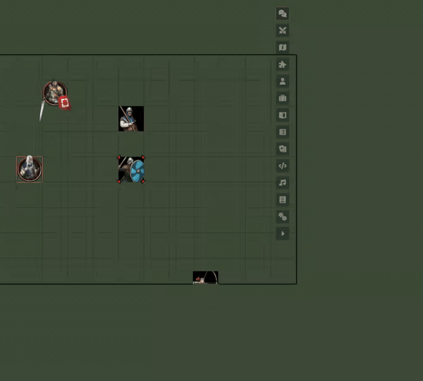

# PF2e AuTOMATO

Модуль для pf2e в Foundry VTT v14. Когда персонаж использует предмет, заклинание или способность, модуль запускает испытания, ставит зоны и накладывает состояния и эффекты по итогу. Он заменяет pf2e-automations, а недостающие правила ведущий дописывает сам в Мастерской, без JSON.

> **Тестовая версия 0.2.0. Перед установкой сделайте копию мира.**

## Что умеет

- Запускает испытания целей из карточки в чате и накладывает состояния по степеням успеха. NPC бросают сами, игроки — кнопкой.
- Держит состояние или эффект на токенах, пока они внутри зоны.
- Шёпотом с кнопкой подсказывает ответные действия и «Блок щитом».
- Следит за ограничениями способностей: досягаемостью Удара, «раз за раунд», дальностью заклинаний. Нарушение модуль не пропускает и объясняет, Alt при клике обходит запрет.
- Ведёт недуги по стадиям, наносит яд на оружие, поддерживает метамагию. В конце хода снижает испуг, в начале хода присылает кнопку против тошноты.
- В Мастерской вы создаёте правила, эффекты и предметы.
- Автоматизации pf2e-automations перенесены почти полностью (97,5%). В остальном компендиуме pf2e готовые правила есть у 13,6% документов (2 756 из 20 206).

## Чего пока нет

- Для большей части компендиума правил нет. Модуль пробует угадать их по описанию, но угаданное срабатывает только по вашей кнопке.
- Без ведущего в сети автоматизация не работает.
- Таблицы и случайные эффекты из описаний не распознаются. Проверка дальности не работает на гексагональной сетке.
- Версия тестовая, ошибки возможны. Подробнее — на странице [чего пока нет](docs/wiki/limitations.md).

## Установка

На экране настройки Foundry откройте вкладку «Модули», нажмите «Установить модуль» и вставьте в поле «Ссылка манифеста»:

`https://github.com/StompingRhino/pf2e-automato/releases/latest/download/module.json`

Нужен socketlib; рекомендуются libWrapper, pf2e-toolbelt и token-action-hud-pf2e. Подробнее: [установка](docs/wiki/install.md).

**Несовместим с pf2e-automations — отключите его.** Вместе они обрабатывают предметы дважды.

## Быстрый старт

1. Сделайте копию мира, включите socketlib и PF2e AuTOMATO, отключите pf2e-automations.
2. Зайдите ведущим и используйте предмет или заклинание. Если для него есть правило, в карточке в чате появится блок «Автоматизация».
3. Нажимайте кнопки блока по ходу действия. Правила нет — допишите его в Мастерской, кнопка «Мастерская» стоит в шапке вкладки «Предметы».

## Вики

[Оглавление](docs/wiki/home.md): [установка](docs/wiki/install.md), [что модуль делает в игре](docs/wiki/usage.md), [Мастерская](docs/wiki/workshop.md), [настройки](docs/wiki/settings.md), [чего пока нет](docs/wiki/limitations.md).

## Нашли ошибку

Пишите в [Issues](https://github.com/StompingRhino/pf2e-automato/issues). Укажите версии Foundry, pf2e и модуля и приложите вывод консоли (F12).

Для разработчиков — `docs/dev/`.

## Лицензия

Код модуля — MIT (`LICENSE`). Правила и эффекты, перенесённые из pf2e-automations, — MIT, © 2024 reyzor1991 (`NOTICE`).

Игровые механики и названия — Paizo Inc., используются по [Paizo Community Use Policy](https://paizo.com/licenses/communityuse) и ORC License (ремастер), полный текст уведомлений — `NOTICE`. Модуль не публикуется, не одобряется и не поддерживается Paizo. Русская терминология — по pf2ru-translation.
