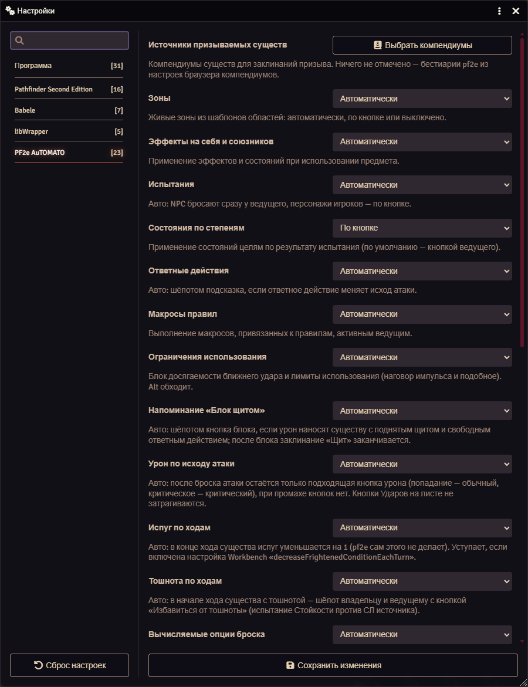

# Настройки

Настройки лежат в «Настройки → Настройки модулей → PF2e AuTOMATO». Почти все — настройки мира, их меняет только ведущий. «Показывать окно ответного действия» и «Отладка» у каждого игрока свои.

Большинству настроек доступны значения «Автоматически», «По кнопке» и «Выключено». Настройки, помеченные ниже «авто / выкл.», имеют только два значения: «Автоматически» и «Выключено».

| Название | Значения | Что делает |
|---|---|---|
| Зоны | авто / по кнопке / выкл. | Живые зоны из шаблонов областей |
| Эффекты на себя и союзников | авто / по кнопке / выкл. | Применение эффектов и состояний при использовании предмета |
| Испытания | авто / по кнопке / выкл. | Авто: NPC бросают сразу у ведущего, персонажи игроков — по кнопке |
| Состояния по степеням | авто / по кнопке / выкл. | Применение состояний целям по результату испытания. По умолчанию — по кнопке ведущего |
| Ответные действия | авто / выкл. | Подсказка шёпотом, если ответное действие меняет исход атаки |
| Макросы правил | авто / выкл. | Макросы из правил выполняет активный ведущий |
| Ограничения использования | авто / выкл. | Блок досягаемости ближнего удара и лимиты использования (наговор импульса и подобное). Alt обходит |
| Вычисляемые опции броска | авто / выкл. | Условие, которое видно на сцене (Стайный — союзники у цели), считает модуль, а переключатель pf2e на листе и в HUD убран. Выкл.: переключатель возвращается |
| Напоминание «Блок щитом» | авто / выкл. | Кнопка блока шёпотом, когда существо с поднятым щитом и свободным ответным действием получает урон |
| Испуг по ходам | авто / выкл. | В конце хода существа испуг уменьшается на 1 |
| Тошнота по ходам | авто / выкл. | В начале хода существа с тошнотой — шёпот владельцу и ведущему с кнопкой «Избавиться от тошноты» |
| Урон по исходу атаки | авто / выкл. | После броска атаки остаётся только подходящая кнопка урона, при промахе кнопок нет |
| Уступать pf2e-automations | вкл. / выкл. | Не выполнять правила для предметов, которые уже покрывает активная группа pf2e-automations. Нужна только если вы сознательно оставили этот модуль включённым |
| Использовать Toolbelt Target Helper | вкл. / выкл. | Если Target Helper включён, броски испытаний делает он, а не модуль |
| Видимость бросков NPC | публично / только ведущий | Кто видит броски NPC |
| Заметка недуга | публично / только ведущий | Что модуль не автоматизирует в недуге (нельзя снять, смерть, превращение) |
| Показывать окно ответного действия | вкл. / выкл. | Небольшое окно с кнопками «Использовать» / «Пропустить», когда вам пришла подсказка об ответном действии |
| Метки видимости в PF2e Vision | вкл. / выкл. | Если активен PF2e Vision, дым, слепота и невидимость ставят метки в его матрицу вместо состояний на актёре |
| Засчитывать сообщения Sustain pf2e | вкл. / выкл. | Действие «Поддержать», выложенное в чат, засчитывается поддерживаемому заклинанию |
| Давность дозапуска (минуты) | 1–1440, по умолчанию 30 | Сообщения старше этого окна не дозапускаются сами: кнопка «Дозапустить» остаётся |
| Источники призываемых существ | выбор компендиумов | Откуда брать существ для заклинаний призыва. Ничего не отмечено — бестиарии pf2e |
| Отладка | вкл. / выкл. | Подробный лог в консоль, только на вашем клиенте |

Если автоматика вам мешает, переключите нужную настройку в «Выключено» — вернётся обычное поведение pf2e.
