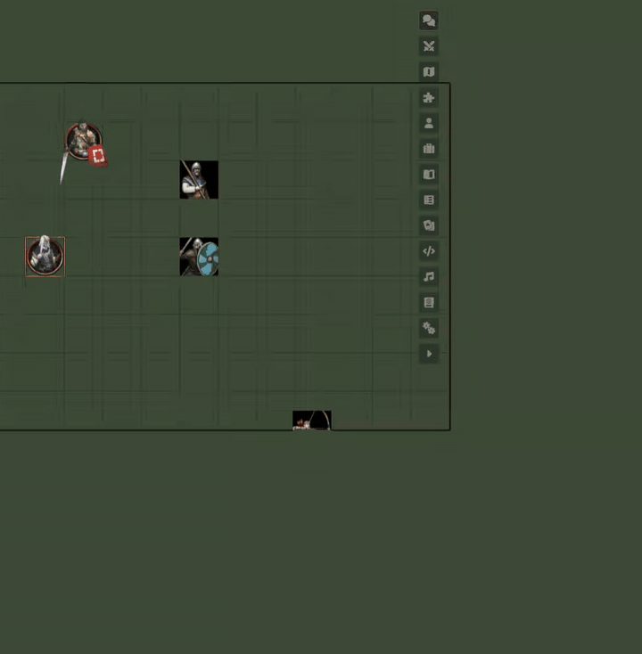
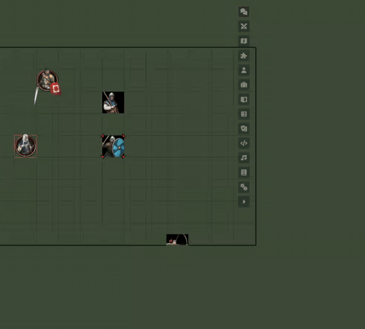
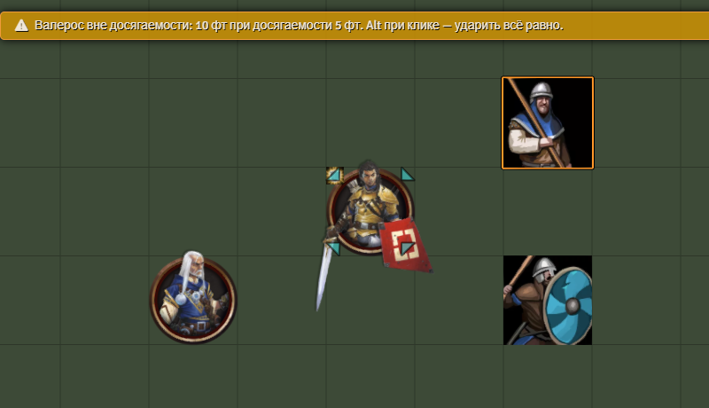
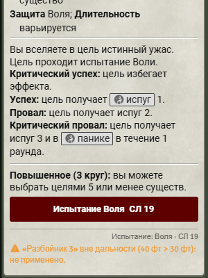
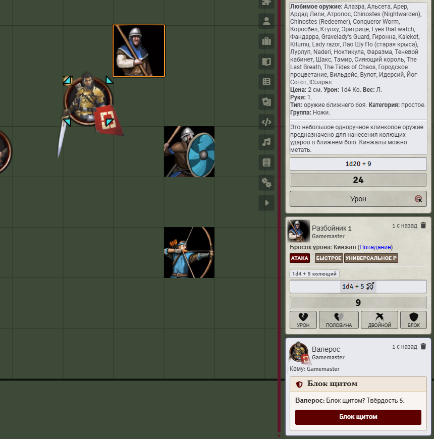

# Что модуль делает в игре

Игрок использует предмет, заклинание или способность — в чате появляется обычная карточка pf2e. Если у предмета есть правило, к ней добавляется блок «Автоматизация»: статус и кнопки следующих шагов. Всё исполняет клиент активного ведущего.

## Кнопки в блоке «Автоматизация»

«Бросить», «Применить», «Отменить», «Создать зону», «Закрыть зону», «Ввести СЛ», «Дозапустить». Кнопка следующего шага появляется, когда шаг наступил.

## Типичный ход

1. **Область.** Игрок или вы ставите шаблон с карточки или из описания, и цели берутся из него. Чтобы перенести область, удалите её (значок корзины на карточке или сам шаблон на сцене) — кнопка «Разместить» вернётся; новые цели заменят старые, а уже применённые результаты сохранятся.
2. **Зона.** Если у предмета есть зона, состояние или эффект действуют, пока токен внутри. Срок зоны — по времени мира, по раундам боя или пока вы не нажмёте «Закрыть зону».
3. **Испытание.** NPC бросают сами у ведущего, персонажи игроков — кнопкой у владельца. Подойдёт и обычный бросок спасброска в чате (в том числе переброс и очко героя). После применения результата переброс помечается, а вам приходит шёпот.
4. **Состояния и эффекты по степеням успеха.** По умолчанию вы жмёте «Применить» сами; можно включить автоматическое применение ([настройки](./settings.md)). «Отменить» откатывает применённое.
5. **Урон.** Всегда кнопкой «Урон». Продолжительный урон накладывается кнопкой по итогу испытания цели.

Если ведущего не было в сети, а карточка уже появилась, нажмите «Дозапустить»: свежие карточки подхватятся и сами при входе ведущего.

## Если правила у предмета нет

Модуль пробует угадать правило по описанию (проверки, ссылки, блоки степеней). Угаданное само ничего не делает. Вы видите подсказку «Возможно: …» и нажимаете «Применить (распознано)» по каждому шагу. Игрокам подсказки не показываются. Исправить или дописать правило можно во вкладке «Автоматизация» листа предмета или в [Мастерской](./workshop.md).

## Что видит только ведущий

- **Шёпоты ведущему** про реакции, перебросы и «Блок щитом».
- **Ограничения использования.** Если действие нельзя применить (импульс без кинетической ауры, второе переполнение за раунд, Удар вблизи вне досягаемости), модуль не даёт его сделать и пишет, что не так. Alt при клике обходит запрет — это решение ведущего.
- **Дальность заклинаний.** Цели вне дальности помечаются «вне дальности» и не получают ни испытаний, ни эффектов.

## Ответные действия

- Если ответное действие меняет исход попадания, владельцу и вам приходит шёпот с кнопкой.
- Реакции-Удары («Внеочередная атака», у NPC — Attack of Opportunity): шёпот владельцу и ведущему с кнопкой «Ударить». Срабатывает на действие с дальней атакой, манипуляцией или перемещением, а в бою и на проход токена через досягаемость. Кнопка срабатывает один раз.
- **Блок щитом.** Когда существо с поднятым щитом и свободной реакцией получает урон, приходит шёпот «Блок щитом? Твёрдость N» с кнопкой. Она применяет урон и тратит реакцию. После блока заклинание «Щит» снимается.

## Действия, которые бросают Удары сами

Для Двойного взмаха, Двойного финта, Устрашающего удара и Танца клинков модуль показывает диалог «оружие + текущий штраф за множественную атаку» (его выбирает игрок) и сам делает броски. Если игрок онлайн, диалог у него, а вы только применяете состояния.

## Переменное число действий

Заклинание с временем «1 to 3», «1 or 2» или «2 or 3»: сразу после сотворения модуль спрашивает у того, кто его использует, сколько действий потрачено. У «Силового залпа» снарядов столько, сколько потрачено действий (плюс за ранги выше базового); при нескольких целях открывается окно распределения, на каждую цель идёт один бросок урона. «Магия крови» (аберрантное наследие) срабатывает один раз за сотворение, окно открывается у игрока-заклинателя.

## Метамагия

Нажмите действие метамагии (на листе или в Token Action HUD) перед сотворением. Переключателя на листе нет. Эффект помечается «(потрачена)» после сотворения и снимается следующим сотворением, в конце хода или при выборе другой метамагии. Метамагии с дополнительным выбором (тип урона и т. п.) по-прежнему работают через переключатель.

«Руки-щупальца» после сотворения дают на 1 минуту безоружные Удары с досягаемостью 10 фт. Продление до 20 фт вручную.

## Другие автоматизации

- **Один выстрел, один труп.** Инициатива Скрытностью даёт эффект «готов» и подсказку про Взаимодействие; снимается после первого урона огнестрелом или арбалетом и по концу боя.
- **Стайный.** Бонус считается при броске урона по союзникам цели в досягаемости, переключателя нет.
- **Испуг и тошнота.** В конце хода испуг уменьшается на 1. В начале хода существа с тошнотой вам и владельцу приходит шёпот с кнопкой «Избавиться от тошноты» (Стойкость против СЛ источника; успех −1, крит. успех −2). Кнопку можно жать повторно, каждый раз это 1 действие.
- **Освобождение** (Захват, Опутывающая лиана). После наложения жертве и вам приходит шёпот с кнопками Атлетика / Акробатика (и «Безоружная атака»). Успех снимает наложенное.
- **Внезапная атака.** После инициативы Обманом или Скрытностью плут получает эффект: существа, ещё не ходившие, застигнуты врасплох для его Ударов и заклинаний-атак.
- **Двойной финт.** Нужна ровно одна цель и два ближних оружия в руках.
- **Перекат за спину.** Перед броском нацельте пересечённого врага; успех даёт плуту эффект «до конца хода» и метку на этого врага. Жуткие удары pf2e считает сам.
- **Недуги со стадиями** (яды, болезни, проклятия). Модуль ведёт стадию на значке эффекта, а спасброски вызывает в конце интервала стадии. Вручную: клик по значку вверх повышает стадию (и наносит урон), вниз — лечит.
- **Нанесение яда на оружие.** Яд действует на цель первого Удара этим оружием. Оружие выбирается в окне; второй яд на том же оружии заменяет первый, и вам приходит шёпот.
- **Окна выбора** (например, оружие для Рунного оружия) открываются у игрока, который использовал предмет, если он в сети, иначе у вас.

## Token Action HUD

Если установлен token-action-hud-pf2e, во вкладке «Эффекты» появляются кнопки «Укрытие» и «Надёжное укрытие». Укрытие ставится вручную, повторный клик его снимает. У оружия с Перезарядкой без заряженного боеприпаса атаки заменяются кнопкой «Перезарядка».
