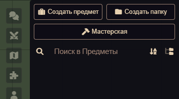
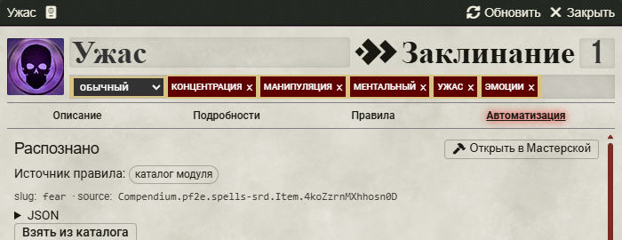
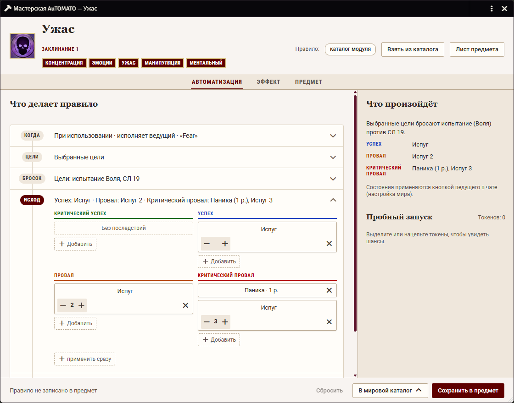
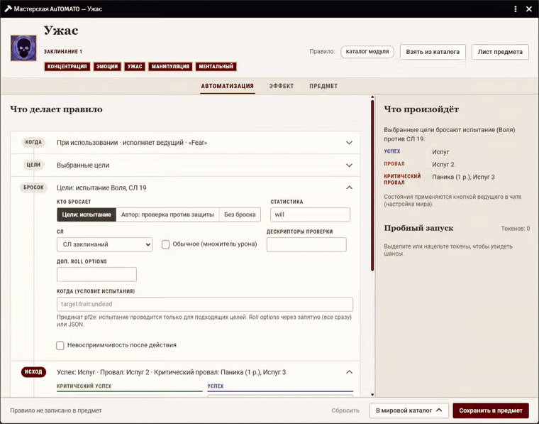
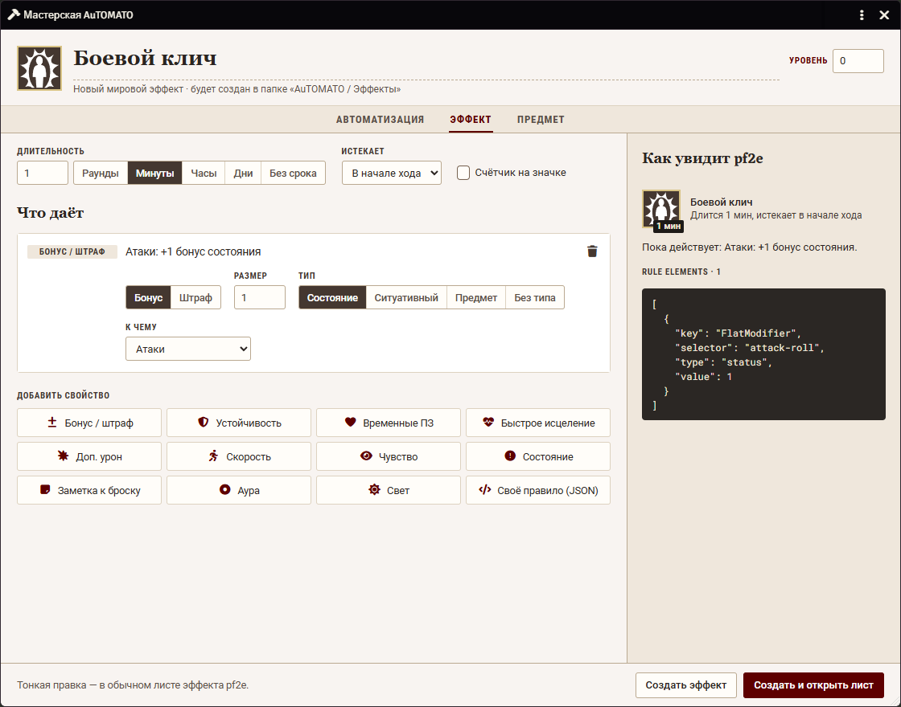
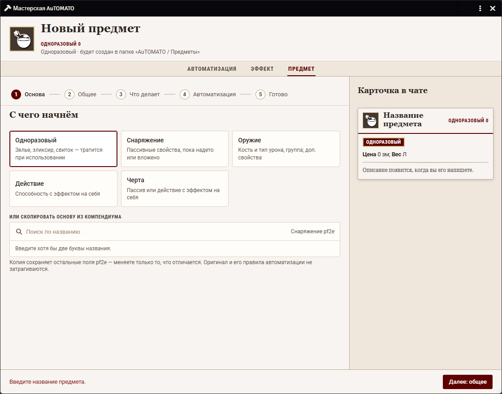

# Мастерская

Окно, где ведущий без JSON создаёт и правит автоматизацию, эффекты и предметы. Доступна только ведущему.

## Как открыть

- Кнопка «Мастерская» в шапке вкладки «Предметы» боковой панели.
- Кнопка во вкладке «Автоматизация» на листе любого предмета. Она открывает Мастерскую сразу в режиме «Автоматизация» для этого предмета.

В окне три режима: «Автоматизация», «Эффект» и «Предмет». «Автоматизация» доступна, когда открыт конкретный предмет.

## Режим «Автоматизация»: правило предмета

Здесь задаётся, что происходит при использовании предмета, заклинания или способности: испытание цели, состояния и эффекты по степеням успеха, макросы и т. д. Правило складывается из шагов в колонках степеней, как в карточке в чате.

**Откуда берётся правило.** В окне указан один из источников:

1. флаг предмета — правило сохранено в самом предмете;
2. мировой каталог — правило, сохранённое вами «для всех» предметов с тем же источником или названием;
3. каталог модуля — готовые правила, которые идут с модулем;
4. разметка описания — модуль угадал правило по тексту. Такое правило помечено как неточное и само ничего не делает, шаги применяются кнопкой.

Приоритет сверху вниз: правило в предмете сильнее мирового каталога, мировой каталог сильнее каталога модуля, а он сильнее разметки.

**Что можно делать**

- Добавлять шаги кнопкой «+ Добавить», перетаскивать состояния, эффекты и макросы из компендиума.
- Принимать «призрачные» плашки «возможно: …» в колонках степеней: клик добавляет шаг. Строка «Не вешается автоматически» перечисляет то, что модуль распознать не смог.
- Выбирать, когда срабатывает правило: «При использовании», «Когда атакуют владельца», «Получит урон», «Провал проверки», «Только макросы», а также по событию.
- Править недуги со стадиями целиком (название, спасбросок, стадии с уроном и состояниями).
- Смотреть в блоке «Пробный запуск» шансы по степеням для выделенных или нацеленных токенов (только для «При использовании»).

**Сохранение**

- «Сохранить в предмет» — правило ляжет в предмет. Если предмет лежит в заблокированном компендиуме, записать в него нельзя; тогда используйте «В мировой каталог».
- «В мировой каталог» открывает меню с пунктами «Для всех с этим источником» и «Для всех с этим slug»: правило будет действовать на все копии предмета. В том же меню правило можно убрать из мирового каталога.
- «Убрать из предмета» удаляет правило из предмета, «Сбросить» отбрасывает несохранённые правки.
- Точка у статуса значит, что есть несохранённые изменения. Закрытие и смена предмета спросят, что делать с ними.

## Режим «Эффект»: новый эффект

Конструктор эффекта pf2e без JSON. Задайте название, уровень, значок, длительность (раунды, минуты, часы, дни или без срока), момент истечения (в начале или в конце хода) и счётчик на значке.

В блоке «Что даёт» добавьте свойства: «Бонус / штраф», «Устойчивость», «Временные ПЗ», «Быстрое исцеление», «Доп. урон», «Скорость», «Чувство», «Состояние», «Заметка к броску», «Аура», «Свет» или «Своё правило (JSON)». Справа видно, как это увидит pf2e. Кнопки «Создать эффект» и «Создать и открыть лист» кладут эффект в мировую папку «AuTOMATO / Эффекты». Тонкую настройку делайте потом в обычном листе эффекта pf2e.

## Режим «Предмет»: новый предмет

Мастер из шагов: «Основа», «Общее», «Что делает», «Автоматизация», «Готово». Шаги можно проходить в любом порядке.

1. «Основа» — тип предмета (одноразовый, снаряжение, оружие, действие, черта) и, по желанию, копия основы из компендиума. Оригинал при этом не меняется.
2. «Общее» — название, цена, вес, редкость, заряды, описание и т. д.
3. «Что делает» — эффект, который накладывается на использующего или на цель (для одноразовых и действий), или свойства, пока предмет надет (снаряжение и оружие).
4. «Автоматизация» — модуль может собрать правило сам; «Открыть в конвейере» доступно после создания предмета.
5. «Готово» — что будет создано и куда: «Только в мир» или «В мир и выдать выделенному».

«Создать предмет» кладёт его в мировую папку «AuTOMATO / Предметы».

## Ограничения

Мастерская правит и создаёт предметы мира. Предметы из заблокированных компендиумов сохраняются только в мировой каталог.
